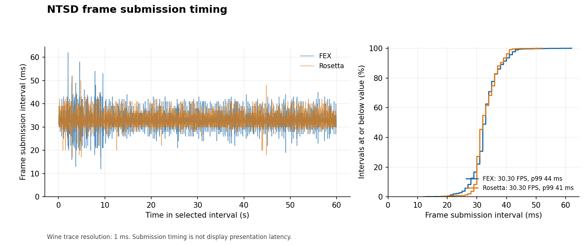
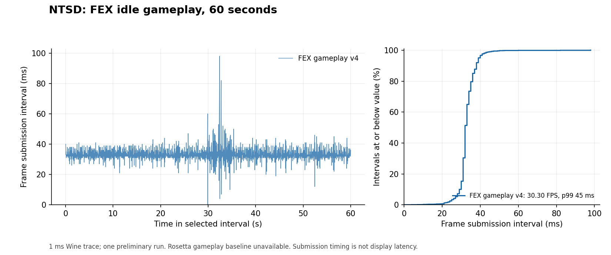

# Paired frame-time comparison — 19 October 2026

Revision **2.8.3.3.7** fixes Rosetta startup and permits the same original-game
scene to run under both wrappers. Each fullscreen sample spans 60 selected
seconds, with one game running at a time.

| Runtime | Average submissions/s | Mean | p50 | p95 | p99 | Maximum | >50 ms |
| --- | ---: | ---: | ---: | ---: | ---: | ---: | ---: |
| ARM64 Wine 11.18 / FEX | 30.30 | 33.00 ms | 33 ms | 41 ms | 44 ms | 62 ms | 5 |
| Intel Wine 11.0_1 / Rosetta, bridge fixed | 30.30 | 33.00 ms | 32 ms | 40 ms | 41 ms | 52 ms | 1 |

Both maintain the game's roughly 30 FPS cadence in this scene. Rosetta has
slightly lower tail intervals in this particular run. A single capped sample
cannot establish a general performance winner, CPU headroom or power efficiency.



Raw data: [FEX CSV](../benchmarks/2026-10-19/fex-fullscreen-v7.csv),
[FEX JSON](../benchmarks/2026-10-19/fex-fullscreen-v7.json),
[Rosetta CSV](../benchmarks/2026-10-19/rosetta-fullscreen-v7.csv),
[Rosetta JSON](../benchmarks/2026-10-19/rosetta-fullscreen-v7.json).
Each contains 1,818 frame submissions / 1,817 intervals. Selected durations are
59.958 s (FEX) and 59.961 s (Rosetta); neither sample has an interval over 100 ms.

## Workload and limits

Apple M4 Pro, 24 GB, macOS 27.0.1 (26A434). Two human-controlled characters,
Naruto and Sasuke, idle with no AI or input during capture; Wharf background,
Jounin difficulty, normal defense, fixed **Main Theme** music and verified
system DirectSound output. Retina is enabled. Both fullscreen clients measure
**6016×3384**, with the unchanged **1333×730** logical canvas scaled into a
**6016×3295** viewport and black borders. Scene settings and healthy idle
characters were checked visually before and after each capture.

The measured apps are signed revision 7 candidates with the final CPU bridge,
display DLL and game code. Their outer identity and
`NTSD_WINEDEBUG=+timestamp,+bitblt` were changed for tracing. After capture, the
launcher’s configuration-helper deadline increased from 8 to 30 seconds; that
startup-only change does not execute during these intervals. Release apps
contain no test environment overrides. The original game EXE is
unchanged, SHA-256 `5eda51440039099069d041e5bd13fde8be9fd8c7b20983985b1712a59719d86b`.

Timestamps come from the final full-viewport **NtGdiStretchBlt** for one stable
window DC. These are **GDI submission intervals**, not physical presentation
or input-latency measurements. Resolution is 1 ms; percentiles use linear
interpolation. Loading, resizing and fullscreen transitions are excluded, with
five seconds of additional warmup before the selected interval. Spawn positions
and animation phases are not deterministic. Other desktop/build activity was
present, including release source packaging; this is a preliminary comparison,
not an isolated lab benchmark. No combat-heavy workload was measured.

This compares the complete shipped wrappers, including their different Wine
versions. It does not isolate translator overhead. FEX runs Wine's host code
natively on ARM64 and translates the game's x86 code; the retained Intel build
uses Rosetta for Wine and x86 game execution. FEX requires macOS 27+, while the
Rosetta wrapper declares macOS 11+. Physical Intel hardware and older macOS
versions were not tested in this run.

The revision 4 windowed measurement below uses a different wrapper, resolution
and music selection; it is retained as historical evidence.

---

# Historical measurements — revision 4 / failed revision 6 baseline

The valid gameplay sample is **FEX only**. There is no valid paired Rosetta
match sample on this Mac, so these measurements establish no performance winner.

| Workload | Runtime | Average FPS | p50 | p95 | p99 | Maximum |
| --- | --- | ---: | ---: | ---: | ---: | ---: |
| Idle gameplay, 60 s | ARM64 Wine 11.18 / FEX, wrapper 2.8.3.3.4 | 30.30 | 32 ms | 39 ms | 45 ms | 98 ms |

1818 frames / 1817 intervals over 59.970 seconds; mean 33.005 ms. Five intervals
exceeded 50 ms; none exceeded 100 ms. Raw [CSV](../benchmarks/2026-10-18/fex-gameplay-v4.csv)
and [JSON](../benchmarks/2026-10-18/fex-gameplay-v4.json) accompany the result.



## Method and limits

Apple M4 Pro, 24 GB, macOS 27.0.1 (26A434). Same original NTSD.exe
SHA-256 `5eda51440039099069d041e5bd13fde8be9fd8c7b20983985b1712a59719d86b`.
Naruto and Sasuke, two human players, no AI, Wharf background, normal defense,
Jounin setting, 1333×730 client, Retina enabled, system audio. This sample
predates the new scaling DLL and is not a benchmark of enlarged/fullscreen revision 6.

Wine's `+timestamp,+bitblt` trace records the final full-window NtGdiStretchBlt
for a stable destination window DC. Inter-frame differences measure **GDI
submission cadence**, not physical display presentation or input latency.
Timestamp resolution is 1 ms. Tracing has overhead, other desktop applications
were present, and this is a single preliminary run. Percentiles use linear
interpolation between sorted intervals.

Rosetta did not produce a valid baseline on the test host. Initial GUI
queries timed out. Controlled revision 6 startup traces then exposed stack
overflow/page-fault errors after the first full-window draw, including a run
without the scaling DLL and with system audio. The same gameplay workload
could not be established and verified.
The Windows DirectSound and shared display integration probes pass under
Rosetta. That is useful compatibility evidence, but cannot supply a gameplay
frame-time comparison. A separately instrumented Wine 11.18 Intel reference also crashed;
it is excluded and the retained Rosetta build keeps Wine 11.0_1.

A capped frame rate alone cannot establish CPU headroom, power efficiency or a
translation speed advantage. Both routes translate the Windows game's x86 code;
FEX also avoids Rosetta for the Wine host. Use the playable FEX build on this macOS 27 host. The Rosetta download remains
a legacy fallback for other macOS configurations, with this failure recorded.
No numeric FPS or percentile is assigned to its failed startup.

[Rosetta failed-baseline record](../benchmarks/2026-10-19/rosetta-baseline-failure.json).

## Reproducing the analysis

Use `NTSD_WINEDEBUG=+timestamp,+bitblt` when launching an isolated test app.
Identify the stable full-window destination DC in the trace, exclude loading
and interactions, and select an equal interval for each runtime:

```sh
python3 tools/trace_frames.py trace.log --dst 0x1201007e --start START_SECONDS --end END_SECONDS --out result
# Plotting was done with matplotlib 3.9.4 in an isolated build environment.
python3 tools/plot_frame_times.py 'FEX=result.csv' --out frame-times.png
```

The DC and timestamps are specific to each run. Inspect the selected workload
before treating it as comparable. The method uses [Wine's bitblt trace](https://github.com/wine-mirror/wine/blob/wine-11.18/dlls/win32u/bitblt.c).
